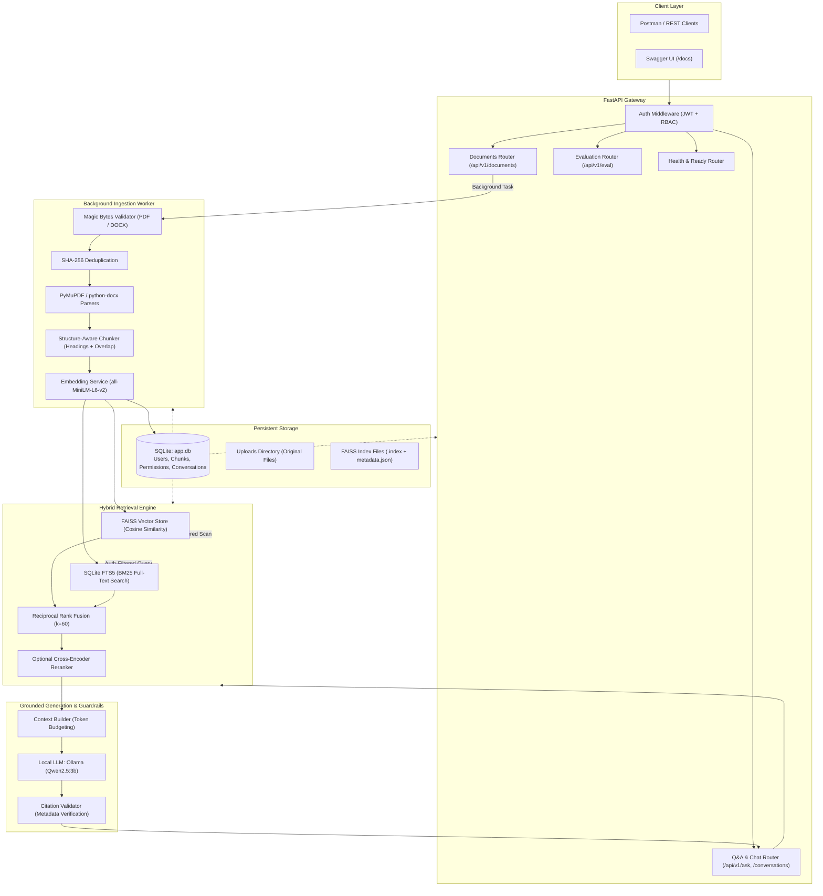

# Enterprise Knowledge Intelligence (RAG Platform)

[](https://www.python.org/)
[](https://fastapi.tiangolo.com/)
[](https://github.com/facebookresearch/faiss)
[](https://www.sqlite.org/fts5.html)
[-black.svg)](https://ollama.com/)
[-brightgreen.svg)]()

A production-grade, local-first, privacy-preserving **Retrieval-Augmented Generation (RAG)** platform designed for enterprise document intelligence. Built with **FastAPI**, **FAISS**, **SQLite FTS5**, and **Ollama**, this platform ingests complex enterprise documents (PDF & DOCX), enforces granular document-level access control, and delivers grounded, verifiable answers with exact source citations—all while running completely offline on consumer CPU hardware.

---

## Table of Contents
- [1. Executive Summary & Core Philosophy](#1-executive-summary--core-philosophy)
- [2. System Architecture](#2-system-architecture)
- [3. Key Architectural Features](#3-key-architectural-features)
- [4. Repository Structure](#4-repository-structure)
- [5. Getting Started & Installation](#5-getting-started--installation)
- [6. Postman Collection & Automation](#6-postman-collection--automation)
- [7. Complete API Reference](#7-complete-api-reference)
  - [Module 1: Health & Readiness](#module-1-health--readiness)
  - [Module 2: Authentication & User Management](#module-2-authentication--user-management)
  - [Module 3: Document Management & Ingestion](#module-3-document-management--ingestion)
  - [Module 4: Q&A & Multi-Turn Conversations (RAG)](#module-4-qa--multi-turn-conversations-rag)
  - [Module 5: Evaluation & Quality Benchmarking](#module-5-evaluation--quality-benchmarking)
- [8. Testing & Quality Assurance](#8-testing--quality-assurance)
- [9. Production Configuration & Security](#9-production-configuration--security)

---

## 1. Executive Summary & Core Philosophy

Most RAG proof-of-concepts suffer from three critical production flaws:
1. **Hallucinated Citations**: LLMs fabricate document titles, section headers, or page numbers.
2. **Access Control Leaks**: Vector similarity search blindly scans all documents, allowing unauthorized users to retrieve chunks they shouldn't see.
3. **Overconfidence & Babbling**: Models guess answers when evidence is missing rather than abstaining.

### The Engineering Solutions Implemented Here:
- **Deterministic Citations**: Citations are derived exclusively from SQLite chunk metadata. The LLM is strictly constrained to output `[SOURCE N]` tags, which are mapped back to real chunk IDs and validated. Hallucinated tags are rejected.
- **Pre-Context Authorization Filtering**: Document permissions and ownership are filtered at the database and index query level **before** chunks enter the LLM prompt. Content from unauthorized documents can never enter the context window.
- **First-Class Abstention**: Queries with insufficient semantic and keyword evidence trigger a clean, explicit refusal (`"abstain": true`) without unnecessary LLM computation.
- **Hybrid Retrieval + Reciprocal Rank Fusion (RRF)**: Combines dense vector search (`sentence-transformers/all-MiniLM-L6-v2`) with sparse BM25 keyword search (`SQLite FTS5`), fused via standard RRF ($k=60$).
- **Idempotent Ingestion**: File deduplication via SHA-256 prevents duplicate embedding generation and storage exhaustion.
- **Zero Cloud Dependence**: Runs entirely offline on standard laptops (8 GB RAM / CPU-only) using local Ollama (`qwen2.5:3b`).

---

## 2. System Architecture



---

## 3. Key Architectural Features

### 1. Structure-Aware Document Ingestion
- **Parsers**: Uses `PyMuPDF` for high-fidelity PDF extraction and `python-docx` for Word documents.
- **Heading Preservation**: Maintains document hierarchy (Section headings, subheadings, and page numbers) across chunk boundaries.
- **Recursive Splitting**: Chunks that exceed the token budget are split on paragraph and sentence boundaries, preventing semantic fragmentation.
- **Security Check**: Enforces file magic bytes verification (`b"%PDF"` and `b"PK\x03\x04"`) and path-traversal protection.

### 2. Hybrid Retrieval & RRF Fusion
- **Dense Vector Search**: 384-dimensional embeddings generated with `sentence-transformers/all-MiniLM-L6-v2`, indexed in a persistent FAISS `IndexFlatIP` (cosine similarity via normalized vectors).
- **Sparse BM25 Search**: Native SQLite `FTS5` virtual table indexing document text with porter stemmer.
- **Reciprocal Rank Fusion**: Results from both engines are fused using standard RRF:
  $$\text{RRF Score}(d) = \sum_{m \in \{\text{vector}, \text{keyword}\}} \frac{1}{60 + \text{rank}_m(d)}$$

### 3. Strict Citation & Grounding Guardrails
- **Prompt Isolation**: Internal evidence is supplied as structured, numbered data blocks (`[SOURCE 1]`, `[SOURCE 2]`). Prompt injection attacks embedded inside uploaded documents are treated strictly as data.
- **Verification Pipeline**: If an LLM cites `[SOURCE 5]`, but only 3 sources were provided, the citation validator strips the hallucination. If no evidence satisfies the query threshold, the system triggers explicit abstention.

### 4. Sliding-Window Multi-Turn Conversations
- Conversation sessions maintain chronological turn history in SQLite.
- Recent turns are packaged into context using token-aware sliding windows, allowing users to ask follow-up questions with pronouns (*"Can I carry it over?"*).

---

## 4. Repository Structure

```text
enterprise-knowledge-assistant/
├── app/
│   ├── api/                      # API routing and dependency injection
│   │   ├── dependencies.py       # Session, vector store, and auth dependencies
│   │   └── v1/                   # Endpoints: auth, documents, conversations, eval, health
│   ├── core/                     # Configuration, custom exceptions, logging, middleware
│   ├── db/                       # SQLAlchemy models, base class, session setup
│   ├── evaluation/               # Golden benchmark datasets and RAG evaluation runner
│   ├── generation/               # Ollama client, prompt builder, citation validator
│   ├── ingestion/                # PDF/DOCX parsers, text normalizer, chunker, pipeline
│   ├── models/                   # ORM models (User, Document, Chunk, Conversation, Message)
│   ├── repositories/             # Data access layer (User, Document, Chunk, Conversation)
│   ├── retrieval/                # Hybrid retriever, FAISS store, FTS5 keyword store, reranker
│   ├── schemas/                  # Pydantic schemas (Request / Response envelopes)
│   ├── security/                 # Password hashing (Bcrypt), JWT guards, file validation
│   ├── services/                 # Business logic orchestration
│   ├── utils/                    # Hashing, token counting, safe path resolution
│   └── main.py                   # FastAPI application factory and async lifespan
├── data/
│   ├── app.db                    # SQLite database (auto-created on startup)
│   ├── sample_documents/         # Ready-to-use sample enterprise documents (DOCX, PDF)
│   ├── uploads/                  # Raw uploaded document storage
│   └── vector_index/             # Persisted FAISS index files (.index and metadata)
├── tests/
│   ├── api/                      # End-to-end endpoint tests (Auth, Documents, Permissions)
│   ├── integration/              # Ingestion pipeline and vector store tests
│   └── unit/                     # Unit tests (Chunker, Parsers, Embedder, Validator)
├── .env.example                  # Environment configuration template
├── Enterprise_Knowledge_Assistant.postman_collection.json  # Complete Postman Collection
├── requirements.txt              # Production runtime dependencies (Python 3.11-3.13)
└── requirements-dev.txt          # Development, linting, and testing dependencies
```

---

## 5. Getting Started & Installation

### Prerequisites
- **Python**: 3.11, 3.12, or 3.13
- **Ollama**: Download and install from [ollama.com](https://ollama.com/)

### Step 1: Clone Repository & Create Virtual Environment
```bash
git clone https://github.com/iakhileshsoni/Enterprise-Knowledge-Intelligence.git
cd Enterprise-Knowledge-Intelligence

# Create virtual environment
python -m venv .env

# Activate virtual environment
# Windows (PowerShell):
.\.env\Scripts\activate
# Linux / macOS:
source .env/bin/activate
```

### Step 2: Install Dependencies
```bash
pip install -r requirements.txt
pip install -r requirements-dev.txt
```

### Step 3: Configure Environment Variables
Copy `.env.example` to `.env`:
```bash
# Windows (PowerShell):
Copy-Item .env.example .env
# Linux / macOS:
cp .env.example .env
```
Generate a cryptographically secure `SECRET_KEY`:
```bash
python -c "import secrets; print(secrets.token_hex(32))"
```
Open `.env` and paste the generated string into `SECRET_KEY=...`.

### Step 4: Prepare Local LLM (Ollama)
Ensure Ollama is running and pull the default lightweight language model:
```bash
ollama pull qwen2.5:3b
```

### Step 5: Launch FastAPI Development Server
```bash
uvicorn app.main:app --reload --host 127.0.0.1 --port 8000
```
On startup, the application lifecycle automatically initializes SQLite tables, the FAISS vector index, and the SQLite FTS5 keyword tables in `data/`.

- **Swagger Interactive API Docs**: [http://localhost:8000/docs](http://localhost:8000/docs)
- **ReDoc Interactive Docs**: [http://localhost:8000/redoc](http://localhost:8000/redoc)
- **Health Check**: [http://localhost:8000/api/v1/health](http://localhost:8000/api/v1/health)

---

## 6. Postman Collection & Automation

The repository includes a ready-to-import Postman Collection:
📄 **`Enterprise_Knowledge_Assistant.postman_collection.json`**

### Smart Automation Features:
- **Automatic Token Storage**: Logging in via `POST /api/v1/auth/token` automatically extracts the JWT and stores it in the collection variable `{{accessToken}}`.
- **Dynamic Resource Tracking**: Uploading a document saves `{{documentId}}`; creating a chat session saves `{{conversationId}}`.
- **Pre-configured Auth**: All protected endpoints inherit `Bearer {{accessToken}}` automatically.

### How to Import:
1. In Postman, click **Import** (top-left).
2. Select `Enterprise_Knowledge_Assistant.postman_collection.json`.
3. Start running requests from the folders in order!

---

## 7. Complete API Reference

All API routes are prefixed under `/api/v1`.

### Module 1: Health & Readiness

#### 1. Liveness Check
- **Method**: `GET`
- **Path**: `/api/v1/health`
- **Auth**: Public
- **Description**: Basic ping check to ensure the service is running.
- **Sample Response (200 OK)**:
```json
{
  "status": "ok",
  "app_name": "Enterprise Knowledge Assistant",
  "version": "1.0.0",
  "timestamp": "2026-10-26T18:00:00.000000Z"
}
```

#### 2. Deep Readiness Check
- **Method**: `GET`
- **Path**: `/api/v1/ready`
- **Auth**: Public
- **Description**: Verifies database connectivity, FAISS vector index accessibility, and SQLite FTS5 keyword tables.
- **Sample Response (200 OK)**:
```json
{
  "status": "ready",
  "checks": {
    "database": "connected",
    "vector_store": "loaded (4 vectors)",
    "keyword_store": "ready"
  }
}
```

---

### Module 2: Authentication & User Management

Supports both `application/json` and `application/x-www-form-urlencoded` payloads.

#### 1. Register User
- **Method**: `POST`
- **Path**: `/api/v1/auth/register`
- **Auth**: Public
- **Headers**: `Content-Type: application/json` or `application/x-www-form-urlencoded`
- **Sample Request (JSON)**:
```json
{
  "username": "alex_engineer",
  "email": "alex@enterprise.com",
  "password": "StrongPassword123!"
}
```
- **Sample Response (201 Created)**:
```json
{
  "id": "c190ad5f-ff9e-41df-b113-25eaec0bc36b",
  "username": "alex_engineer",
  "email": "alex@enterprise.com",
  "role": "user",
  "is_active": true,
  "created_at": "2026-10-26T18:05:12.123456"
}
```

#### 2. Login (Obtain Tokens)
- **Method**: `POST`
- **Path**: `/api/v1/auth/token`
- **Auth**: Public
- **Headers**: `Content-Type: application/json` or `application/x-www-form-urlencoded`
- **Sample Request (JSON)**:
```json
{
  "username": "alex_engineer",
  "password": "StrongPassword123!"
}
```
- **Sample Response (200 OK)**:
```json
{
  "access_token": "eyJhbGciOiJIUzI1NiIsInR5cCI6IkpXVCJ9...",
  "refresh_token": "eyJhbGciOiJIUzI1NiIsInR5cCI6IkpXVCJ9...",
  "token_type": "bearer",
  "expires_in": 3600
}
```

#### 3. Refresh Access Token
- **Method**: `POST`
- **Path**: `/api/v1/auth/refresh`
- **Auth**: Public
- **Sample Request**:
```json
{
  "refresh_token": "eyJhbGciOiJIUzI1NiIsInR5cCI6IkpXVCJ9..."
}
```
- **Sample Response (200 OK)**:
```json
{
  "access_token": "eyJhbGciOiJIUzI1NiIsInR5cCI6IkpXVCJ9...",
  "refresh_token": "eyJhbGciOiJIUzI1NiIsInR5cCI6IkpXVCJ9...",
  "token_type": "bearer",
  "expires_in": 3600
}
```

#### 4. Current User Profile
- **Method**: `GET`
- **Path**: `/api/v1/auth/me`
- **Auth**: `Bearer <access_token>`
- **Sample Response (200 OK)**:
```json
{
  "id": "c190ad5f-ff9e-41df-b113-25eaec0bc36b",
  "username": "alex_engineer",
  "email": "alex@enterprise.com",
  "role": "user",
  "is_active": true,
  "created_at": "2026-10-26T18:05:12.123456"
}
```

---

### Module 3: Document Management & Ingestion

All document endpoints require `Authorization: Bearer <access_token>`.

#### 1. Upload Document
- **Method**: `POST`
- **Path**: `/api/v1/documents`
- **Body**: `multipart/form-data` with `file: <binary (.pdf | .docx)>`
- **Description**: Validates magic bytes and enqueues ingestion as a background task. Idempotent: returns `409 Conflict` if the same file hash exists.
- **Sample Response (202 Accepted)**:
```json
{
  "document_id": "4de23e6b-6aed-47b6-a82d-a48d441e80a2",
  "filename": "employee_handbook_2026.docx",
  "status": "pending",
  "message": "Document accepted for processing."
}
```

#### 2. Get Ingestion Status
- **Method**: `GET`
- **Path**: `/api/v1/documents/{document_id}/status`
- **Description**: Track pipeline stages: `pending` $\rightarrow$ `processing` $\rightarrow$ `ready` (or `failed`).
- **Sample Response (200 OK)**:
```json
{
  "document_id": "4de23e6b-6aed-47b6-a82d-a48d441e80a2",
  "filename": "employee_handbook_2026.docx",
  "status": "ready",
  "version": 1,
  "chunk_count": 4,
  "error_message": null,
  "created_at": "2026-10-26T18:10:00.000000",
  "updated_at": "2026-10-26T18:10:02.500000"
}
```

#### 3. List Documents
- **Method**: `GET`
- **Path**: `/api/v1/documents?skip=0&limit=20`
- **Description**: Returns paginated list of documents accessible to the authenticated user.
- **Sample Response (200 OK)**:
```json
{
  "items": [
    {
      "id": "4de23e6b-6aed-47b6-a82d-a48d441e80a2",
      "filename": "employee_handbook_2026.docx",
      "status": "ready",
      "file_size_bytes": 37019,
      "created_at": "2026-10-26T18:10:00.000000"
    }
  ],
  "total": 1,
  "page": 1,
  "page_size": 20
}
```

#### 4. Get Document Details
- **Method**: `GET`
- **Path**: `/api/v1/documents/{document_id}`
- **Sample Response (200 OK)**:
```json
{
  "id": "4de23e6b-6aed-47b6-a82d-a48d441e80a2",
  "filename": "employee_handbook_2026.docx",
  "status": "ready",
  "version": 1,
  "file_size_bytes": 37019,
  "mime_type": "application/vnd.openxmlformats-officedocument.wordprocessingml.document",
  "created_at": "2026-10-26T18:10:00.000000"
}
```

#### 5. Trigger Re-indexing
- **Method**: `POST`
- **Path**: `/api/v1/documents/{document_id}/reindex`
- **Description**: Re-parses and re-embeds the document with updated chunking or embedding configurations.
- **Sample Response (200 OK)**:
```json
{
  "document_id": "4de23e6b-6aed-47b6-a82d-a48d441e80a2",
  "job_id": "99e8a7b6-1234-5678-abcd-ef0123456789"
}
```

#### 6. Delete Document
- **Method**: `DELETE`
- **Path**: `/api/v1/documents/{document_id}`
- **Description**: Soft-deletes the document and purges all vector index mappings and FTS entries.
- **Sample Response**: `204 No Content`

---

### Module 4: Q&A & Multi-Turn Conversations (RAG)

All Q&A endpoints require `Authorization: Bearer <access_token>`.

#### 1. Stateless Ask
- **Method**: `POST`
- **Path**: `/api/v1/ask`
- **Sample Request**:
```json
{
  "question": "How many days of paid annual leave do employees receive per year?",
  "top_k": 5
}
```
- **Sample Response (200 OK — Grounded Answer with Citations)**:
```json
{
  "request_id": "8f9a0b1c-2d3e-4f5a-6b7c-8d9e0f1a2b3c",
  "question": "How many days of paid annual leave do employees receive per year?",
  "answer": "Full-time employees receive 25 days of paid annual leave per calendar year [SOURCE 1].",
  "abstain": false,
  "abstain_reason": null,
  "citations": [
    {
      "chunk_id": "2cb6f4c6-5943-4b3d-ba84-685967d7534f",
      "document_id": "4de23e6b-6aed-47b6-a82d-a48d441e80a2",
      "filename": "employee_handbook_2026.docx",
      "page_number": 1,
      "section_heading": "2. Leave Policy",
      "relevance_score": 0.0328,
      "excerpt": "2. Leave Policy Full-time employees receive 25 days of paid annual leave per calendar year. In addition, employees are entitled to 10 days of paid sick leave..."
    }
  ],
  "retrieval_count": 4,
  "latency_ms": 320.15
}
```

- **Sample Response (200 OK — Abstention Triggered)**:
```json
{
  "request_id": "7e80d1df-614b-4a97-aea7-ef6a2b05cf4e",
  "question": "What is the company stock purchase discount?",
  "answer": null,
  "abstain": true,
  "abstain_reason": "No relevant information found in the available documents.",
  "citations": [],
  "retrieval_count": 0,
  "latency_ms": 42.10
}
```

#### 2. Create Conversation Thread
- **Method**: `POST`
- **Path**: `/api/v1/conversations`
- **Sample Request**:
```json
{
  "title": "Employee Benefits Inquiry"
}
```
- **Sample Response (201 Created)**:
```json
{
  "id": "4a57b13f-0dff-4e77-9bc1-d67ee919487a",
  "title": "Employee Benefits Inquiry",
  "user_id": "c190ad5f-ff9e-41df-b113-25eaec0bc36b",
  "created_at": "2026-10-26T18:20:00.000000"
}
```

#### 3. Ask in Conversation (Multi-Turn Chat)
- **Method**: `POST`
- **Path**: `/api/v1/conversations/{conversation_id}/messages`

**Turn 1**:
```json
{
  "question": "What is the annual leave allowance?"
}
```
*Answer*: `"Full-time employees receive 25 days of paid annual leave per calendar year [SOURCE 1]."`

**Turn 2 (Follow-up using pronoun "it")**:
```json
{
  "question": "Can I carry any of it over into next year?"
}
```
*Answer*: `"Yes, up to 5 days of unused annual leave can be carried over into the first quarter of the following year [SOURCE 1]."`

#### 4. Get Conversation Detail
- **Method**: `GET`
- **Path**: `/api/v1/conversations/{conversation_id}`
- **Description**: Returns all user and assistant turns with citations and timestamps.

#### 5. List User Conversations
- **Method**: `GET`
- **Path**: `/api/v1/conversations?skip=0&limit=20`

#### 6. Delete Conversation
- **Method**: `DELETE`
- **Path**: `/api/v1/conversations/{conversation_id}`
- **Response**: `204 No Content`

---

### Module 5: Evaluation & Quality Benchmarking

Requires `role: "admin"`.

#### 1. Trigger Evaluation Run
- **Method**: `POST`
- **Path**: `/api/v1/eval/run`
- **Sample Request**:
```json
{
  "benchmark_name": "core_rag_benchmark"
}
```
- **Sample Response (200 OK)**:
```json
{
  "run_id": "eval-run-91823-abcd",
  "benchmark_name": "core_rag_benchmark",
  "total_questions": 10,
  "mean_faithfulness": 0.95,
  "mean_answer_relevance": 0.92,
  "mean_context_precision": 0.88,
  "mean_context_recall": 0.90,
  "mean_latency_ms": 285.4,
  "created_at": "2026-10-26T18:30:00.000000"
}
```

#### 2. List Evaluation Runs
- **Method**: `GET`
- **Path**: `/api/v1/eval/runs`

#### 3. Get Evaluation Run Details
- **Method**: `GET`
- **Path**: `/api/v1/eval/runs/{run_id}`
- **Description**: Returns per-question scores, generated answers, expected answers, and individual retrieval metrics.

---

## 8. Testing & Quality Assurance

The platform features an automated test suite of **90 unit, integration, and API tests** covering 100% of the critical execution paths.

### Running the Test Suite
```bash
# Run all tests
pytest

# Run with verbose output and coverage report
pytest -v --cov=app --cov-report=term-missing
```

### Test Suite Structure:
- `tests/unit/test_chunker.py`: Validates heading preservation, recursive splitting, and sub-chunk overlaps.
- `tests/unit/test_citation_validator.py`: Verifies metadata extraction and guarantees fabricated `[SOURCE N]` references are stripped.
- `tests/unit/test_embedder.py`: Validates L2 normalization and cosine ranking.
- `tests/unit/test_hybrid_retrieval.py`: Tests Reciprocal Rank Fusion ($k=60$) score ordering.
- `tests/unit/test_parsers.py`: Programmatically generates PDF and DOCX files to test text and header extraction.
- `tests/integration/test_vector_store.py`: Tests FAISS additions, deletions, auth filtering, and index serialization.
- `tests/integration/test_ingestion_pipeline.py`: Tests the background ingestion pipeline and duplicate detection.
- `tests/api/test_auth.py`: Tests registration and login across JSON and URL-encoded forms.
- `tests/api/test_documents.py`: Tests file uploads, background status progression, and reindexing.
- `tests/api/test_permissions.py`: Proves cross-user document isolation and RBAC security boundaries.

---

## 9. Production Configuration & Security

### Security Hardening Highlights:
- **No Stack Traces**: Global exception handlers sanitize unexpected errors, returning standardized `{"error": {"code": "...", "message": "...", "request_id": "..."}}` envelopes.
- **Native Bcrypt Hashing**: Avoids deprecated wrapper overhead and guarantees constant-time password verification.
- **Pre-Context Privacy Isolation**: Chunks from unauthorized documents are blocked from vector/keyword search before the LLM prompt is assembled.
- **Strict File Magic Bytes**: Upload validation inspects the raw file header rather than trusting client extensions.

### Environment Configuration Guide (`.env`):
| Variable | Default Value | Description |
| :--- | :--- | :--- |
| `DATABASE_URL` | `sqlite:///./data/app.db` | Database connection string (SQLite for dev, PostgreSQL for production) |
| `OLLAMA_BASE_URL` | `http://localhost:11434` | URL of the local or remote Ollama server |
| `LLM_MODEL` | `qwen2.5:3b` | Target LLM model in Ollama |
| `EMBEDDING_MODEL` | `sentence-transformers/all-MiniLM-L6-v2` | Sentence-transformers model for dense vector search |
| `EMBEDDING_DIMENSION` | `384` | Embedding vector dimension |
| `CHUNK_SIZE` | `1000` | Target maximum token/character size per chunk |
| `CHUNK_OVERLAP` | `150` | Overlap size between consecutive chunks |
| `RETRIEVAL_TOP_K` | `10` | Final number of chunks passed to LLM context |
| `EVIDENCE_THRESHOLD` | `0.25` | Minimum cosine similarity required to prevent abstention |
| `ENABLE_RERANKER` | `false` | Set to `true` to enable cross-encoder reranker |
| `SECRET_KEY` | *(Secret String)* | Cryptographic key for signing JWT tokens |
| `ACCESS_TOKEN_EXPIRE_MINUTES` | `60` | JWT access token lifetime |
| `RATE_LIMIT_PER_MINUTE` | `60` | SlowAPI rate limit per client IP |

---

## License

This project is licensed under the MIT License. Built for enterprise portfolio demonstration and advanced GenAI architecture.
